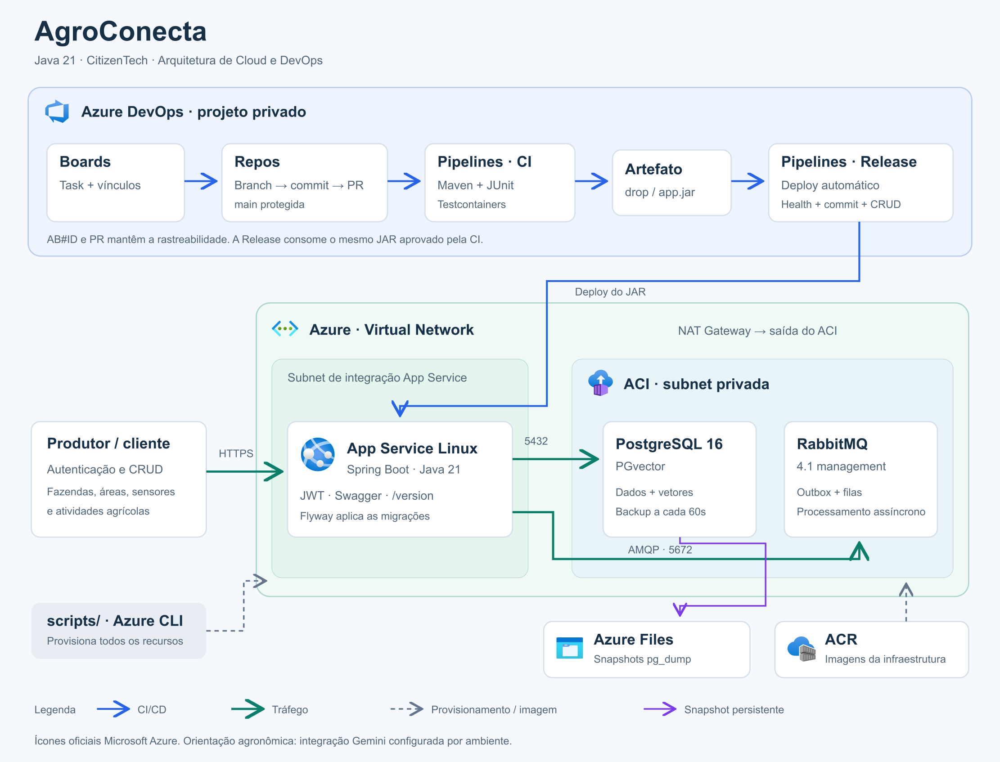

# AgroConecta

**Global Solution 2026/2 · CitizenTech**  
DevOps Tools & Cloud Computing

| Integrante | RM |
|---|---|
| Felipe Wiclif Leal da Silva · representante | 563901 |
| Deryk de Souza Queiroz | 563412 |
| Lucas Gonçalves Viana | 563254 |
| Vinicius Paschoeto da Silva | 563089 |

## Ambiente publicado

| Recurso | Endereço |
|---|---|
| Organização Azure DevOps | https://dev.azure.com/RM563254/ |
| Projeto privado | https://dev.azure.com/RM563254/AgroConecta-GS-2026 |
| API no Azure | https://app-agro563901gs.azurewebsites.net |
| Swagger | https://app-agro563901gs.azurewebsites.net/swagger-ui/index.html |
| Health | https://app-agro563901gs.azurewebsites.net/actuator/health |
| Versão e commit | https://app-agro563901gs.azurewebsites.net/version |
| Pipelines | https://dev.azure.com/RM563254/AgroConecta-GS-2026/_build |

[Verificação do ambiente](VALIDACAO.md)

## Visão geral

O AgroConecta reúne informações de propriedades rurais, áreas de cultivo, sensores e atividades agrícolas. O sistema oferece acompanhamento hídrico, processamento assíncrono, alertas e orientação agronômica com Gemini e recuperação de fontes por PGvector.

A proposta apoia o pequeno produtor na organização dos dados e no acompanhamento de condições do cultivo. Está relacionada aos ODS 2, 6 e 9: agricultura sustentável, gestão da água e infraestrutura digital no campo.

## Arquitetura



[Diagrama vetorial](docs/arquitetura-cloud.svg) · [Decisões de arquitetura](docs/ARQUITETURA-CLOUD.md)

| Componente | Responsabilidade |
|---|---|
| Azure Boards e Repos | Tarefas, branches, commits, revisão e rastreabilidade |
| Azure Pipelines | Compilação, testes, artefatos e publicação automática |
| App Service Linux | Execução do JAR Spring Boot com Java 21 |
| ACI e ACR | PostgreSQL 16/PGvector e RabbitMQ em containers privados |
| VNet e NAT Gateway | Comunicação privada e saída de rede do ACI |
| Azure Files | Armazenamento de snapshots PostgreSQL |

O cliente acessa a API por HTTPS e JWT. A integração do App Service com a VNet permite alcançar o banco e o broker por IP privado. O Flyway controla as migrações do schema. A implantação utiliza a modalidade de banco em container ACI/ACR prevista na disciplina.

## Execução e testes

Pré-requisitos: JDK 21, PowerShell 7.4+ e Docker com engine Linux. O Maven Wrapper acompanha o projeto.

```powershell
./scripts/validar-containers.ps1
```

O comando executa a suíte Maven, inicia a aplicação com perfil `prod`, confere migrações e CRUD com consultas SQL e testa a restauração do snapshot em um PostgreSQL novo. O ambiente é descartável; os relatórios JUnit ficam em `target/cloud-reports`.

Para executar somente Maven:

```powershell
./mvnw.cmd clean verify
```

Em Linux: `chmod +x mvnw && ./mvnw -B -ntp clean verify`.

[Resultados de verificação](VALIDACAO.md) · [Documentação da aplicação](docs/README-APLICACAO.md)

## Implantação no Azure

O passo a passo está em [ANTES-DO-AZURE.md](ANTES-DO-AZURE.md) e [docs/AZURE.md](docs/AZURE.md).

```powershell
Copy-Item config/implantacao.example.json config/implantacao.local.json
# Informe assinatura, prefixo, organização, projeto e e-mails no arquivo local.
az login
./scripts/iniciar-azure.ps1 -Etapa Infraestrutura
./scripts/iniciar-azure.ps1 -Etapa DevOps
```

Faça o primeiro push com os comandos exibidos pela etapa DevOps. Em seguida:

```powershell
./scripts/iniciar-azure.ps1 -Etapa Politicas
./scripts/iniciar-azure.ps1 -Etapa Pipelines
```

| Configuração | Nome |
|---|---|
| Service Connection | `sc-agroconecta-azure` |
| Variable Group e Environment | `agroconecta-prod` |
| Build | `AgroConecta-CI` · `azure-pipeline.yml` |
| Release | `AgroConecta-Release` · `azure-release.yml` |

A Library recebe `RESOURCE_GROUP` e `WEBAPP_NAME`. Os scripts solicitam os segredos por entrada mascarada e os configuram nos serviços. Os recursos consomem a assinatura Azure enquanto estiverem ativos.

## Integração e entrega contínuas

1. Criar a tarefa no Boards e a branch vinculada.
2. Fazer commit com `AB#ID` e abrir PR para `main`.
3. Revisar e concluir a PR conforme as políticas da branch.
4. Executar CI automática: Maven, JUnit, integração, perfil `prod`, CRUD/SQL e restauração.
5. Publicar `drop`, com JAR, checksum, commit, DDL, migrações e relatórios.
6. Acionar a Release automaticamente e publicar o mesmo JAR no App Service.
7. Conferir health, commit e CRUD da aplicação publicada.

O commit da compilação fica embutido em `build-info.properties` e é retornado por `/version`. A Release verifica essa identificação antes do teste remoto.

## API e exemplos de CRUD

Swagger: `/swagger-ui.html` · OpenAPI: `/v3/api-docs`  
Health: `/actuator/health` · Versão: `/version`

Os endpoints de negócio exigem JWT. O token é emitido por `/api/auth/register` ou `/api/auth/login`.

| Entidade | POST | GET / PUT / DELETE |
|---|---|---|
| Propriedade | `/api/farms` | `/api/farms/{id}` |
| Área de cultivo | `/api/crop-areas` | `/api/crop-areas/{id}` |
| Sensor | `/api/sensors` | `/api/sensors/{id}` |
| Atividade | `/api/crop-areas/{areaId}/activities` | `/api/crop-areas/{areaId}/activities/{id}` |

Exemplos de criação; substitua os IDs pelos retornados nas requisições anteriores:

```json
{"name":"Sítio Boa Colheita","city":"Campinas","state":"SP","totalArea":100,"areaUnit":"HECTARE"}
```

```json
{"farmId":1,"name":"Talhão de milho","cropType":"Milho","areaSize":10,"areaUnit":"HECTARE","latitude":-22.9,"longitude":-47.06,"description":"Área de demonstração."}
```

```json
{"cropAreaId":1,"name":"Umidade do solo","deviceCode":"GS-SENSOR-001","sensorType":"SOIL_MOISTURE","installationDate":"2026-11-01","description":"Sensor de demonstração."}
```

```json
{"type":"IRRIGATION","performedAt":"2026-11-01T12:00:00Z","description":"Irrigação registrada.","quantity":20,"unit":"litros"}
```

Os arquivos de criação e atualização estão em `requests/`. GET e DELETE não recebem corpo JSON. A coleção Postman está em `postman/`. Consulte o Swagger e o [contrato completo](docs/README-APLICACAO.md) para perfis, leituras, jobs, alertas, dispositivos, técnicos e orientação agronômica.

## Demonstração e persistência

```powershell
$infra = Get-Content infra-output.json -Raw | ConvertFrom-Json
./scripts/smoke-test.ps1 -BaseUrl $infra.APP_URL -PauseForSql -ResourceGroup $infra.RESOURCE_GROUP -ContainerGroup $infra.CONTAINER_GROUP
```

O script executa CRUD nas quatro entidades e consulta o PostgreSQL por `psql` no ACI. Cada operação tem uma pausa para apresentar o SELECT. Após excluir, a consulta pelo ID deve retornar zero linhas. A limpeza respeita as chaves estrangeiras.

O PostgreSQL mantém snapshots a cada 60 segundos em Azure Files. A restauração utiliza o último snapshot e admite perda das alterações posteriores a ele. A Release atualiza apenas o JAR. [Detalhes de persistência e recuperação](docs/ARQUITETURA-CLOUD.md).

## Configuração e segurança

`POSTGRES_PASSWORD`, `RABBITMQ_PASSWORD` e `JWT_SECRET` devem ser diferentes e ter pelo menos 32 caracteres. A aplicação exige `DB_PASSWORD` e `JWT_SECRET` por ambiente. O arquivo de configuração local não contém senhas e fica fora do versionamento.

A orientação Gemini é habilitada com `GOOGLE_API_KEY` e `APP_AI_ENABLED=true`, ou pelo parâmetro `-EnableAi` no provisionamento. O CRUD, a mensageria e os cálculos determinísticos funcionam sem essa integração. Os provedores usados nos testes ficam restritos à suíte de testes.

## Documentação

- [Configuração Azure](docs/AZURE.md)
- [Arquitetura](docs/ARQUITETURA-CLOUD.md)
- [Fluxos funcionais](docs/DEMONSTRACAO-FUNCIONAL.md)
- [PDF de entrega](entrega/LEIA-ME.md)
- [Base do código](docs/ORIGEM.md)

## Referências

[Azure Repos](https://learn.microsoft.com/en-us/azure/devops/repos/git/branch-policies) · [Azure Pipelines](https://learn.microsoft.com/en-us/azure/devops/pipelines/process/pipeline-triggers) · [App Service Java](https://learn.microsoft.com/en-us/azure/app-service/quickstart-java) · [ACI e VNet](https://learn.microsoft.com/en-us/azure/container-instances/container-instances-vnet) · [Azure Files](https://learn.microsoft.com/en-us/azure/container-instances/container-instances-volume-azure-files) · [Ícones oficiais Azure](https://learn.microsoft.com/en-us/azure/architecture/icons/)
