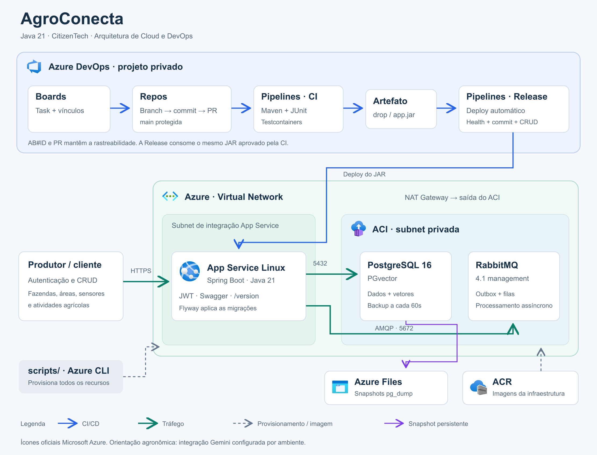

# Arquitetura de Cloud do AgroConecta

## Escolha compatível com a aplicação

A aplicação original utiliza tipos específicos de PostgreSQL (JSONB, UUID, arrays e PGvector). Trocar apenas a string JDBC por Azure SQL ou Oracle não preservaria as migrações e funcionalidades. A entrega adota a opção “banco em container ACI/ACR” da rubrica, mantendo PostgreSQL/PGvector, e hospeda o JAR Spring Boot no App Service Linux Java 21.

## Rede

O App Service recebe HTTPS público. A integração regional com VNet permite acessar o grupo ACI por IP privado. Cada serviço tem sua subnet delegada: Microsoft.Web/serverFarms para App Service e Microsoft.ContainerInstance/containerGroups para ACI. A saída do ACI utiliza NAT Gateway. Não há portas de banco ou broker abertas ao público. A ligação PostgreSQL/AMQP ocorre dentro da rede privada; não foi configurado TLS próprio nesses dois protocolos internos.

## Imagens

Os Dockerfiles da pasta dockerfiles derivam de pgvector/pgvector:pg16 e rabbitmq:4.1-management, as famílias usadas pelo projeto original. Azure CLI/ACR Tasks constrói as imagens no ACR. Uma identidade gerenciada atribuída pelo usuário, com AcrPull no registry, permite que o ACI baixe as imagens sem senha de administrador ACR.

## Persistência e recuperação

ACI não é um serviço gerenciado de banco. PGDATA permanece no disco local do container, sujeito à perda quando o container é recriado. Para a entrega acadêmica, a imagem acrescenta pg_dump consistente para Azure Files a cada 60 segundos e snapshot no encerramento quando possível. No início de um banco vazio, o entrypoint restaura latest.sql e o Flyway aplica migrações ainda pendentes.

A share armazena snapshots SQL, não arquivos transacionais PGDATA. Isso evita depender de permissões/semântica POSIX em SMB para o diretório do PostgreSQL. A versão anterior do snapshot é conservada como previous.sql. O backup não elimina a janela de perda: uma falha abrupta pode perder dados posteriores ao último snapshot, e o tempo para gerar um dump amplia essa janela. O ambiente não oferece HA, PITR nem RPO zero. O comportamento de restauração precisa ser ensaiado antes de confiar na recuperação.

O broker usa armazenamento local do container. Outbox e recuperação de jobs são preservadas no banco conforme o código original, mas não se promete restauração exata da fila após perda do broker. A Release de código não recria esse grupo, limitando as alterações ao App Service. Para produção, seria necessário rever persistência transacional e durabilidade do broker. Uma opção PaaS diferente da lista da GS deve ser previamente alinhada com o professor.

## Build, Release e schema

CI: compila Java, roda testes JUnit/Testcontainers, valida o perfil prod com o JAR, confere CRUD/SELECT e testa restauração em um container PostgreSQL novo; somente depois publica JAR, relatórios, DDL e migrações. O commit é gravado em build-info.properties dentro do JAR. Release: baixa esse artefato, verifica checksum e implanta. Ao iniciar, Flyway executa as migrações versionadas. Não se aplica manualmente o DDL agregado sobre um banco já administrado por Flyway.

scripts/script-bd.sql reúne o DDL das 19 migrações para inspeção/requisito do enunciado e uso em banco vazio; os arquivos originais de migração são a fonte executada pela aplicação. Não altere migrações já aplicadas: crie uma nova versão para evoluir o schema.

## Integrações e limites

JWT, perfis, autorização por proprietário, CRUDs, leituras, atividades, cálculos, jobs, alertas e orientação com Gemini/RAG permanecem no código. A orientação real depende de uma GOOGLE_API_KEY válida e APP_AI_ENABLED=true; por padrão, a IA continua desativada. Dados demonstrativos e simulações devem ser identificados como tal na apresentação e não como medições reais de campo.

Ícones: coleção oficial Microsoft Azure Architecture Icons, preservando forma e proporção. Fonte: https://learn.microsoft.com/en-us/azure/architecture/icons/.
